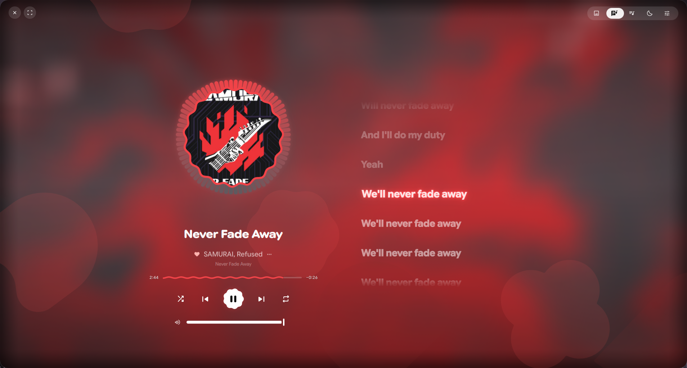
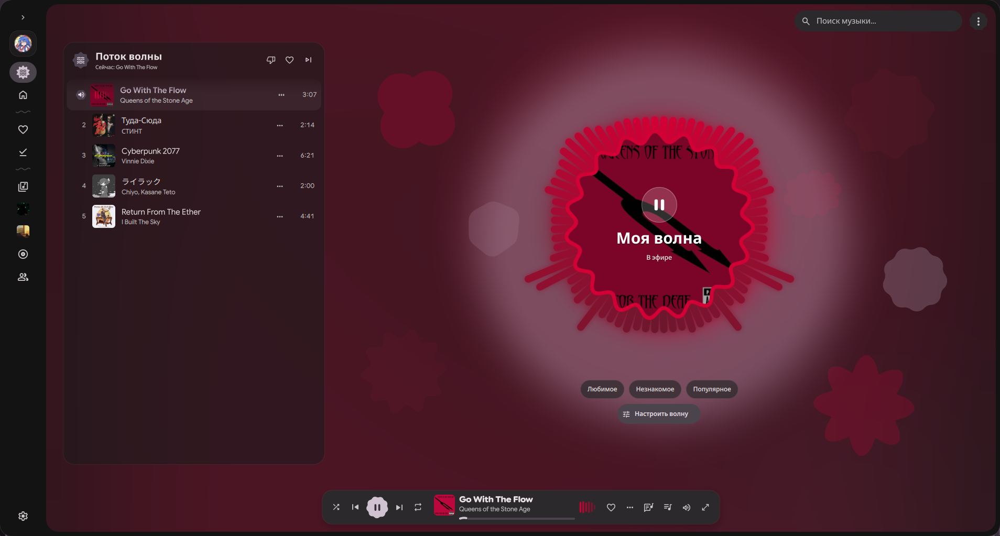
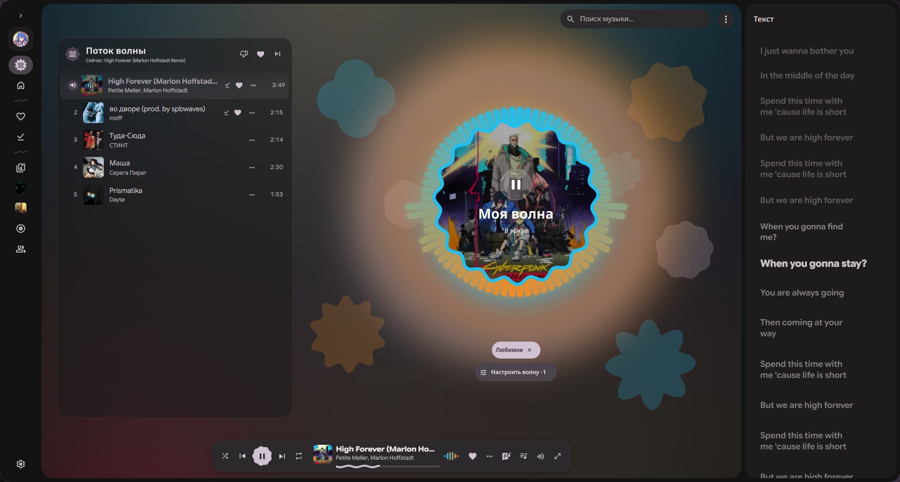
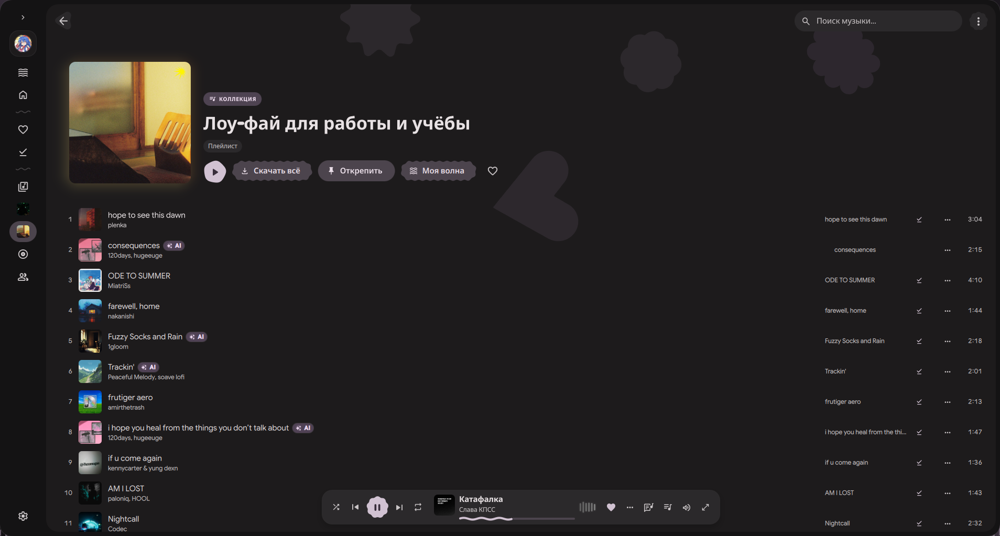

<div align="center">


# ymusic

Нативный десктопный клиент Яндекс Музыки на **Rust** и **Qt Quick / QML**

[](https://github.com/ethermawe/ymusic/releases/latest)
[](https://github.com/ethermawe/ymusic/actions/workflows/ci.yml)
[](src/)
[](src-qt/)
[](https://github.com/ethermawe/ymusic/releases)
[](LICENSE)

[Установка](#установка) · [Скриншоты](#скриншоты) · [Возможности](#возможности) · [Моддинг](docs/MODDING.md) · [Сборка](#сборка-из-исходников) · [Клавиши](#горячие-клавиши)

<br>



</div>

---

**ymusic** — быстрый нативный клиент вместо Electron-обёртки: асинхронное ядро на Rust (`tokio`, `reqwest`, `rodio`) и GPU-интерфейс на Qt Quick в стиле Material 3 Expressive с GLSL-шейдерами.

> Работает через неофициальное API Яндекс Музыки (эндпоинты сверены с [MarshalX/yandex-music-api](https://github.com/MarshalX/yandex-music-api)).

## Скриншоты

| «Моя волна» | «Моя волна» и синхронный текст |
|---|---|
|  |  |

| Плейлист, AI-метки и «Моя волна» по коллекции | Имерсивный плеер |
|---|---|
|  |  |

## Возможности

**Воспроизведение и звук**
- Качество **Обычное / HQ / Lossless FLAC** с переключением на лету без потери позиции
- Быстрый старт после предбуферизации ~96 КБ, предзагрузка следующего трека, нормализация R128, скорость и таймер сна
- Офлайн-раздел «Загружено», автокэш до 1 ГБ, скачивание альбомов/плейлистов и экспорт треков на ПК в **MP3** или **FLAC**

**Моя волна и медиатека**
- Персональная «Моя волна», волны по треку, артисту, альбому и плейлисту, фильтры волны и обратная связь в Rotor API
- «Мне нравится», плейлисты с закреплением, альбомы, артисты, скрытые треки (дизлайки), поиск и история прослушивания
- Вход по **QR-коду** (`ya.ru/device`, OAuth Device Flow) или токену (`~/.config/ymusic/token` / `YM_TOKEN`)

**Интерфейс и кастомизация**
- Полноэкранный имерсивный плеер с шейдерным фоном, визуализаторами спектра и синхронными текстами (LRC / караоке / LRCLIB)
- Динамические светлые и тёмные палитры из обложки, **Theme Studio** (создание, импорт и экспорт тем), интеграция с Quickshell / Noctalia / `wal`
- Система модов на **QML + JS** без пересборки (28 UI-слотов, `overrides`, установка `.ymmod`, Hot Reload) — [docs/MODDING.md](docs/MODDING.md)

**Интеграции и фильтры**
- **MPRIS2** (`playerctl`, Waybar, KDE/GNOME), нативный **Discord Rich Presence**, скробблинг в **Last.fm**
- **SlopLess** — пометка и опциональное скрытие AI-треков по встроенной базе и `slopless.art`

## Установка

Готовые сборки лежат в [GitHub Releases](https://github.com/ethermawe/ymusic/releases/latest):

| Платформа | Формат |
|---|---|
| **Arch Linux** | AUR: `yay -S ymusic-bin` *(или `paru -S ymusic-bin`)*, либо `ymusic-*.pkg.tar.zst` |
| **Linux (x86_64)** | `ymusic-*-linux-x86_64.tar.zst` / `.tar.gz` |
| **Windows (x86_64)** | Установщик `ymusic-*-windows-x86_64-setup.exe`, портативный `.exe` или `.zip` |

## Сборка из исходников

Нужны **Rust** (stable), **CMake ≥ 3.20**, **Ninja** и **Qt 6** (`Core`, `Gui`, `Widgets`, `Quick`, `Qml`, `QuickControls2`, `Network`, `ShaderTools`, `Svg`, `Concurrent`). Шрифты `Google Sans Flex` и `Material Symbols Rounded` скачиваются при первой конфигурации CMake.

<details>
<summary><b>Linux</b></summary>

```sh
cargo build --release --lib
cmake -S src-qt -B build-qt -G Ninja -DCMAKE_BUILD_TYPE=Release
cmake --build build-qt
./build-qt/ymusic-qml
```

Установка в систему: `sudo cmake --install build-qt --prefix /usr/local`

Для локальной сборки пакета Arch из корня репозитория: `makepkg -si`

</details>

<details>
<summary><b>Windows (MSVC + Qt 6)</b></summary>

```powershell
cargo build --release --lib
cmake -S src-qt -B build-qt -A x64
cmake --build build-qt --config Release
cmake --install build-qt --config Release --prefix dist
windeployqt --qmldir src-qt/qml --release --no-translations --no-opengl-sw dist/ymusic-qml.exe
```

</details>

<details>
<summary><b>Параметры сборки и запуска (Last.fm, графика, Discord)</b></summary>

- **Встроенные ключи Last.fm:** задайте `LASTFM_API_KEY` и `LASTFM_API_SECRET` перед `cargo build --release --lib` (либо укажите свои ключи в Настройки → Интеграции).
- **Графический бэкенд:** `./build-qt/ymusic-qml --graphics=vulkan` или `--graphics=opengl`.
- **Безопасный режим (без модов):** `./build-qt/ymusic-qml --safe-mode` (или удерживайте `Shift` при запуске).
- **Discord RPC:** при необходимости ID приложения переопределяется через `YM_DISCORD_CLIENT_ID`. В Vesktop / Vencord локальный предпросмотр статуса не гарантирует видимость для других пользователей.

</details>

## Горячие клавиши

| Клавиши | Действие |
|---|---|
| `Space` | Пауза / воспроизведение *(вне имерсивного режима)* |
| `Ctrl` + `←` / `→` | Предыдущий / следующий трек |
| `Ctrl` + `Alt` + `←` / `→` | Перемотка −10 / +10 с |
| `Ctrl` + `↑` / `↓` | Громкость ±5% |
| `Ctrl` + `Alt` + `M` / `S` / `R` | Mute / Shuffle / Repeat |
| `Ctrl` + `K` или `Ctrl` + `F` | Поиск |
| `Ctrl` + `,` | Настройки |
| `Ctrl` + `Shift` + `R` | Перезагрузка модов *(в режиме разработчика)* |
| `Ctrl` + `+` / `-` / `0` | Масштаб интерфейса |
| `Esc` / `Back` | Назад |

<details>
<summary><b>Структура проекта</b></summary>

```text
ymusic/
├── src/                      # Rust-ядро (ymusic_core)
│   ├── api.rs                # API Яндекс Музыки, Rotor API, OAuth, тексты (LRC/LRCLIB)
│   ├── audio.rs              # Плеер на rodio + FFT-спектр
│   ├── cache.rs              # Потоковый ридер, дисковый кэш, офлайн-загрузки
│   ├── core.rs               # Состояние плеера, очередь, лента, волна
│   ├── wave.rs               # Фильтры «Моей волны»
│   ├── history.rs            # История прослушивания
│   ├── slopless.rs           # Проверка AI-треков (база + slopless.art)
│   ├── lastfm.rs             # Скробблинг Last.fm
│   ├── mpris.rs              # D-Bus MPRIS2
│   ├── discord.rs            # Discord Rich Presence (IPC)
│   ├── config.rs             # Настройки, сессия, keyring
│   ├── dns.rs                # Резолвер с учётом IPv6
│   └── ffi.rs                # C ABI мост
├── src-qt/                   # Qt Quick / C++ фронтенд
│   ├── main.cpp              # Точка входа, трей, single-instance, --safe-mode
│   ├── YMusicBackend.*       # Мост с Rust, модели, ThemeManager
│   ├── mods/                 # ModManager, ModApi, ModUrlInterceptor
│   ├── app/                  # Paths, QrImageProvider, UpdateChecker
│   ├── qml/                  # UI M3 Expressive, Theme Studio, имерсивный плеер
│   └── shaders/              # GLSL-шейдеры (Qt ShaderTools)
├── docs/MODDING.md           # Документация по модам
├── examples/mods/            # Примеры модов
├── packaging/windows/setup/  # Установщик Windows на Rust
└── data/                     # Встроенная база SlopLess
```

</details>

## Лицензия и благодарности

Распространяется под **GNU GPL v3.0 or later** ([LICENSE](LICENSE)).

- Часть QML-компонентов, дизайн-токенов M3 Expressive, подсистемы тем, SceneGraph-рендереров и шейдеров в `src-qt/` адаптирована из [Swiftify](https://github.com/swiftify-org/swiftify) (`Copyright (C) 2026 shred0s`, GPL-3.0-or-later).
- Определение AI-треков использует базу и API [SlopLess](https://slopless.art).
- В `src-qt/third_party/` используются `material-color-utilities` и `rounded-polygon-qmljs` (Apache-2.0).
