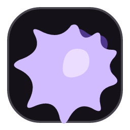

<div align="center">



# ymusic

**Нативный десктопный клиент Яндекс Музыки на Rust + Qt Quick / QML в стиле Material 3 Expressive.**

[](https://github.com/ethermawe/ymusic/releases/latest)
[](https://github.com/ethermawe/ymusic/actions/workflows/ci.yml)
[](LICENSE)

[](src/)
[](src-qt/)
[](https://github.com/ethermawe/ymusic/releases)

**[Возможности](#возможности)** · **[Установка](#установка)** · **[Сборка из исходников](#сборка-из-исходников)** · **[Горячие клавиши](#горячие-клавиши)** · **[Архитектура](#архитектура)** · **[Лицензия](#лицензия-и-благодарности)**

</div>

---

## О проекте

**ymusic** заменяет тяжёлый веб-клиент на быструю связку асинхронного ядра на **Rust** (`tokio`, `reqwest`, `rodio`) и GPU-ускоренного интерфейса на **Qt Quick / QML** с дизайн-системой **Material 3 Expressive** и кастомными GLSL-шейдерами.

> [!NOTE]
> Клиент работает через неофициальное API Яндекс Музыки (эндпоинты сверены с [MarshalX/yandex-music-api](https://github.com/MarshalX/yandex-music-api)).

## Возможности

| Раздел | Что внутри |
|---|---|
| **Авторизация** | Вход по коду устройства (`ya.ru/device`, OAuth Device Flow) или по токену (`~/.config/ymusic/token` / переменная `YM_TOKEN`). Оптимистичный мгновенный старт из локального кэша сессии. |
| **Звук и потоки** | Старт воспроизведения после предбуферизации ~96 КБ, фоновая предзагрузка следующего трека, нормализация громкости (R128), скорость воспроизведения и плавное затухание таймера сна. |
| **Моя волна (Rotor API)** | Персональная волна (`user:onyourwave`), волна по артисту и по треку, тонкая настройка фильтров волны, бесконечная очередь и отправка сигналов (`radioStarted`, `trackStarted`, `trackFinished`, `skip`, `like`, `dislike`). |
| **Имерсивный плеер** | Живой шейдерный фон по цветам обложки, визуализаторы спектра (полосы, круговой и др.), синхронизированные тексты песен (LRC и пословное караоке через Яндекс и LRCLIB), управление очередью и настройка ускоренного перехода. |
| **SlopLess (AI-фильтр)** | Встроенная база и проверка через `slopless.art`: MD3-бейдж `AI` рядом с треками и опциональное скрытие AI-контента. |
| **Медиатека и поиск** | «Мне нравится», плейлисты (создание публичных/приватных, закрепление), альбомы, страницы артистов, единый поиск с фильтрами (всё, треки, альбомы, артисты, плейлисты) и локальная история последних 100 треков. |
| **Офлайн и кэш** | Дисковый кэш аудио и обложек с автоочисткой (лимит 1 ГБ), раздел «Загружено» для воспроизведения без интернета, кнопка «Скачать всё» для альбомов/плейлистов и экспорт в MP3. |
| **Интеграции** | D-Bus **MPRIS2** (`org.mpris.MediaPlayer2.ymusic` для `playerctl`, Waybar, Quickshell, KDE/GNOME), нативный **Discord Rich Presence** («Слушает», обложка, таймер и кнопка трека), системный трей и single-instance. |
| **Оформление** | Динамические палитры из обложки трека, пресеты тем, интеграция с Quickshell / Noctalia / `wal` (`matugen`), настройка скругления, масштаба, скорости прокрутки и анимаций. |

## Установка

Готовые сборки публикуются в [GitHub Releases](https://github.com/ethermawe/ymusic/releases/latest):

- **Arch Linux**: пакет `ymusic-*.pkg.tar.zst` (`pacman -U ...`) или локальная сборка через `makepkg`.
- **Linux (универсальный архив)**: `ymusic-*-linux-x86_64.tar.zst` / `.tar.gz`.
- **Windows**: портативный однофайловый `ymusic-*-windows-x86_64.exe` или `.zip`.

<details>
<summary><b>Локальная сборка пакета для Arch Linux (PKGBUILD)</b></summary>

Из корня локального checkout:

```sh
makepkg -si
```

`PKGBUILD` собирает текущие исходники без скачивания релиза. Рабочие файлы при стандартных настройках помещаются в `build-makepkg/`, не затрагивая каталог `src/`, а тесты прогоняются с изолированными XDG-каталогами. Это локальный рецепт, а не AUR-пакет.

</details>

## Сборка из исходников

Для сборки требуются **Rust** (stable), **CMake ≥ 3.20** (рекомендуется **Ninja**) и **Qt 6** (`Core`, `Gui`, `Widgets`, `Quick`, `Qml`, `QuickControls2`, `Network`, `ShaderTools`, `Svg`, `Concurrent`).

> [!TIP]
> При первой конфигурации CMake автоматически загружает шрифты `Google Sans Flex` и `Material Symbols Rounded` с проверкой SHA-256.

<details>
<summary><b>Linux (Debian / Ubuntu / Arch)</b></summary>

```sh
# 1. Собрать Rust-ядро
cargo build --release --lib

# 2. Сконфигурировать и собрать Qt-клиент
cmake -S src-qt -B build-qt -G Ninja -DCMAKE_BUILD_TYPE=Release
cmake --build build-qt

# 3. Запустить
./build-qt/ymusic-qml
```

Установка в систему (опционально):

```sh
sudo cmake --install build-qt --prefix /usr/local
```

</details>

<details>
<summary><b>Windows (MSVC + Qt 6)</b></summary>

```powershell
cargo build --release --lib
cmake -S src-qt -B build-qt -A x64
cmake --build build-qt --config Release
cmake --install build-qt --config Release --prefix dist
windeployqt --qmldir src-qt/qml --release --no-translations --no-opengl-sw dist/ymusic-qml.exe
```

</details>

### Выбор графического бэкенда

При необходимости можно принудительно сравнить RHI-бэкенды без отключения шейдеров и сглаживания:

```sh
./build-qt/ymusic-qml --graphics=vulkan
./build-qt/ymusic-qml --graphics=opengl
```

> [!NOTE]
> Vulkan требует поддержки со стороны драйвера; при артефактах или сбоях запускайте без флага или с `--graphics=opengl`. Для честного сравнения памяти вместо общего RSS смотрите PSS в `/proc/<PID>/smaps_rollup`.

## Горячие клавиши

| Комбинация | Действие |
|---|---|
| `Space` | Пауза / воспроизведение *(вне имерсивного режима)* |
| `Ctrl` + `←` / `→` | Предыдущий / следующий трек |
| `Ctrl` + `Alt` + `←` / `→` | Перемотка на −10 / +10 секунд |
| `Ctrl` + `↑` / `↓` | Громкость ±5% |
| `Ctrl` + `Alt` + `M` | Выключить / включить звук |
| `Ctrl` + `Alt` + `S` | Перемешать очередь (Shuffle) |
| `Ctrl` + `Alt` + `R` | Режим повтора (Repeat) |
| `Ctrl` + `K` / `Ctrl` + `F` | Фокус на строку поиска |
| `Ctrl` + `,` | Открыть настройки |
| `Ctrl` + `+` / `-` / `0` | Масштаб интерфейса |
| `Esc` / `Back` | Назад по навигации |

<details>
<summary><b>Советы по видимости Discord Rich Presence</b></summary>

- Discord должен быть запущен на компьютере и подключён к сети.
- Проверьте, что в настройках конфиденциальности активности включена публикация текущей активности, нет ограничений на конкретном сервере и не выставлен статус «Невидимый».
- Для **Vesktop / Vencord** проверьте настройки передачи активности: локальный предпросмотр не гарантирует видимость статуса для других пользователей (проверяйте с другого аккаунта).
- Ошибки RPC выводятся в `stderr`. При необходимости можно переопределить ID приложения через переменную окружения `YM_DISCORD_CLIENT_ID` (пользовательский токен Discord не требуется).

</details>

## Архитектура

```text
ymusic/
├── src/                      # Rust-ядро (ymusic_core)
│   ├── api.rs                # HTTP-клиент Яндекс Музыки, Rotor API, OAuth, тексты (LRC/LRCLIB)
│   ├── audio.rs              # Аудиоплеер на rodio в отдельном потоке + спектр
│   ├── cache.rs              # Потоковый StreamReader (Read + Seek), кэш и офлайн-загрузки
│   ├── core.rs               # Состояние, очередь, сессия, лента, волна
│   ├── slopless.rs           # Детектор и фильтр AI-треков (встроенная база + slopless.art)
│   ├── wave.rs               # Настройки и фильтры «Моей волны»
│   ├── history.rs            # Локальная история прослушивания
│   ├── mpris.rs              # D-Bus сервер MPRIS2 (zbus)
│   ├── discord.rs            # Discord Rich Presence через локальный IPC-сокет
│   ├── config.rs             # Токен, пользовательские настройки и сохранённая сессия
│   ├── dns.rs                # DNS-резолвер с учётом доступности IPv6
│   └── ffi.rs                # C ABI мост для Qt/C++
├── src-qt/                   # Qt Quick / C++ фронтенд
│   ├── main.cpp              # Точка входа, трей, single-instance, выбор графики
│   ├── YMusicBackend.*       # C++-мост, модели TrackModel / CardModel, ThemeManager
│   ├── qml/                  # Интерфейс M3 Expressive, настройки, имерсивный плеер
│   └── shaders/              # GPU-эффекты (Qt ShaderTools)
└── data/                     # Встроенная бинарная база SlopLess
```

## Лицензия и благодарности

Проект распространяется под лицензией **GNU General Public License v3.0 or later** ([LICENSE](LICENSE)).

- Значительная часть Qt Quick / QML-компонентов, дизайн-токенов Material 3 Expressive, подсистемы тем, генерации палитр и обложек, SceneGraph-рендереров и GLSL-шейдеров в `src-qt/` портирована и адаптирована из проекта [Swiftify](https://github.com/swiftify-org/swiftify) (`Copyright (C) 2026 shred0s`, GPL-3.0-or-later).
- Rust-бэкенд (`src/`), клиент API Яндекс Музыки, стриминг/кэш, интеграции MPRIS / Discord RPC и специфичные экраны и модели `ymusic` написаны для работы с Яндекс Музыкой.
- Определение AI-музыки опирается на базу и API проекта [SlopLess](https://slopless.art).
- В `src-qt/third_party/` используются сторонние компоненты `material-color-utilities` и `rounded-polygon-qmljs` под лицензией **Apache-2.0**.
